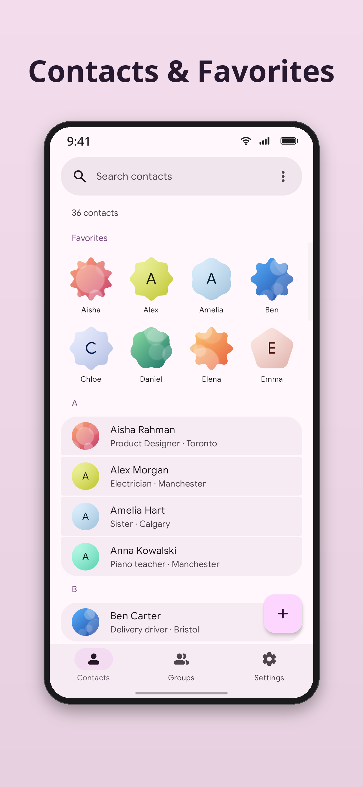
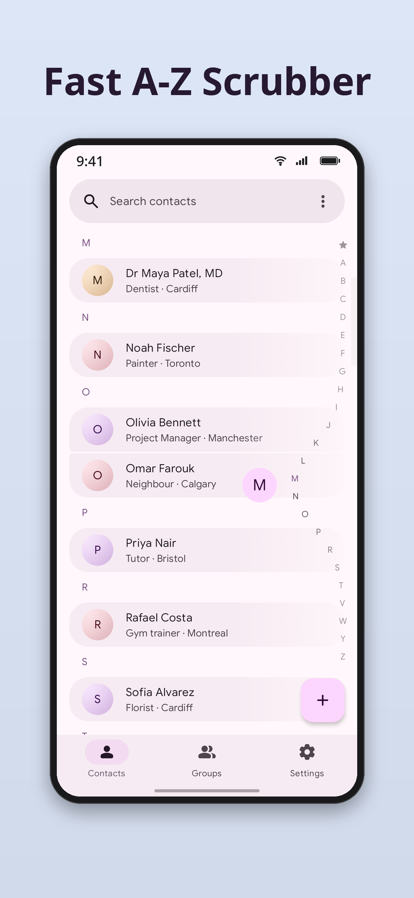
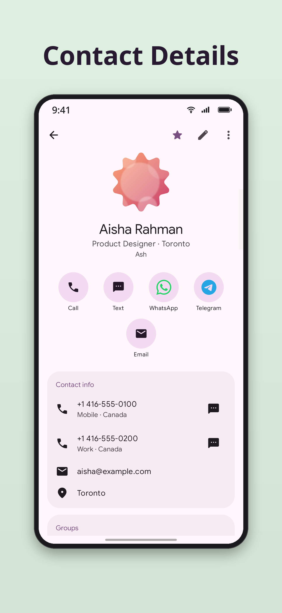
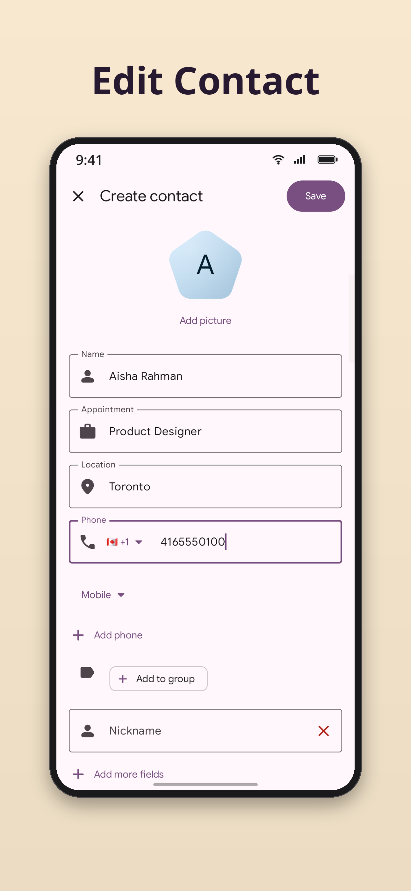
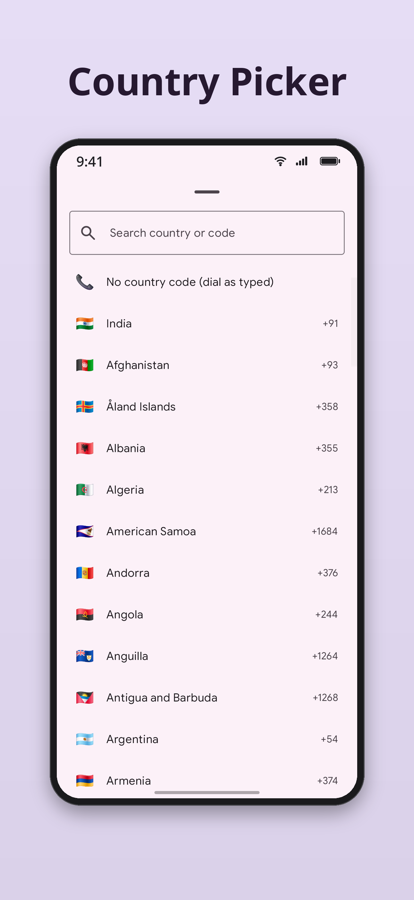
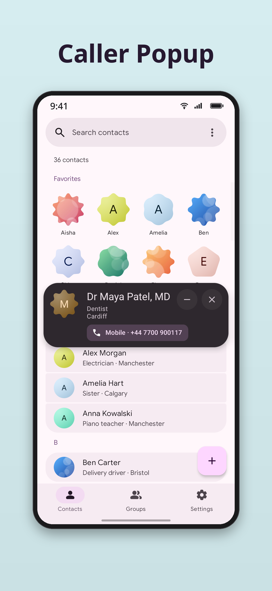

[](https://github.com/sponsors/BioHazard786)
[![IzzyOnDroid][izzyondroid-shield]][izzyondroid-url]
[![Reproducible][reproducible-shield]][reproducible-url]
[![Releases][releases-shield]][releases-url]

[![Sponsors][sponsors-shield]][sponsors-url]
[![Contributors][contributors-shield]][contributors-url]
[![Forks][forks-shield]][forks-url]
[![Stargazers][stars-shield]][stars-url]
[![Issues][issues-shield]][issues-url]
[![MIT License][license-shield]][license-url]

<div align="center">
<a href="https://github.com/BioHazard786/Alternate">
    
</a>
<br />
<br />
    <a href="https://github.com/BioHazard786/Alternate/issues">Report Bug</a>
    ·
    <a href="https://github.com/BioHazard786/Alternate/issues">Request Feature</a>
    <br />
    <br />
</div>

<div align="center">
   <a href="https://apt.izzysoft.de/packages/com.lulu786.Alternate">
      
   </a>
   <a href="https://github.com/BioHazard786/Alternate/releases">
      
   </a>
   <a href="https://www.openapk.net/alternate/com.lulu786.Alternate/">
      
   </a>
   <a href="https://apps.obtainium.imranr.dev/redirect?r=obtainium://add/https://github.com/BioHazard786/Alternate/">
      
   </a>
</div>

<br />

# Alternate - Local Caller ID Detector

A privacy-focused Android app that tells you who is calling without adding them to your phone's contact list. Perfect for numbers you only need to recognise for a while (delivery drivers, repair services, one-off business contacts), because nothing you save here shows up in WhatsApp, Telegram or any other app.

> **Version 3** is a ground-up rewrite in native Kotlin. It installs over 2.x and keeps your contacts, PIN and theme. The old React Native (Expo) app lives on the [`legacy-expo`](https://github.com/BioHazard786/Alternate/tree/legacy-expo) branch.

## Features

- **Caller ID popup**: a Material 3 card over incoming and outgoing calls with the contact's name, appointment, location and number. Drag it, minimise it to a chip, or dismiss it
- **Private by design**: contacts live only in this app's database. They never reach the system contacts, messaging apps or the cloud
- **Dialer integration**: shows your saved names in the Google Phone app's call screen where the system supports it
- **Several numbers per contact**, each with a label (Mobile, Work, or your own) and a country, or saved as typed with no country code (toll-free numbers, STD landlines)
- **Save from recent calls**: pick someone from your call log in the + menu and their number is filled in, no copy and paste
- **Groups and favorites**: organise people into groups like Family or Work, and pin favorites to the top
- **Fast search**: finds names, nicknames, numbers, notes and groups, with the match highlighted
- **Quick scrolling**: a Niagara-style A-Z scrubber with a favorites shortcut
- **Material 3 Expressive**: dynamic color, light, dark and AMOLED themes, and a contact avatar in one of twelve shapes
- **Bulk actions**: select, share, copy, star, group or delete many contacts at once
- **Import and export**: vCard (.vcf) files, including photos and groups
- **App lock**: PIN with optional fingerprint unlock and auto-lock
- **Fully offline**: the app has no `INTERNET` permission

## Upgrading from 2.x

Install the 3.x APK over the old app. The package name and signing key are unchanged, so Android updates in place and your contacts, PIN and theme are carried over on first launch.

## How It Works

1. **Save numbers locally**: add a name, numbers and any details in the app
2. **Recognise calls**: when a call starts, the app looks the number up in its own database and shows the popup
3. **Stay separate**: nothing is written to your device's contacts, so there is nothing for other apps to sync

## Permissions

| Permission                  | Why                                                                                             |
| --------------------------- | ----------------------------------------------------------------------------------------------- |
| Phone state, Call log       | Notice when a call starts and which number is calling, and let you pick a recent caller to save |
| Display over other apps     | Draw the caller popup on top of the dialer                                                      |
| Wake lock, Dismiss keyguard | Show the popup on a locked or sleeping screen                                                   |
| Biometrics                  | Optional fingerprint unlock for the app lock                                                    |

You can also give Alternate the call screening role during setup, which makes caller detection more reliable on recent Android versions. No contacts, location or network permissions are used.

## Tech Stack

- **Kotlin** with **Jetpack Compose** and **Material 3 Expressive**; the call popup uses plain Views and spring animations so it starts instantly from a broadcast
- **Room** for contacts and groups, **DataStore** for settings
- **Coil** for photos, **androidx.biometric** for fingerprint unlock
- minSdk 24 (Android 7.0), target SDK 36

## Screenshots

<p align="center">
  
  
  
</p>
<p align="center">
  
  
  
</p>

## Building

### Prerequisites

- JDK 17 or later (the release workflow uses 21)
- Android SDK with the API 37 platform. Android Studio installs everything needed

### Debug build

```bash
git clone https://github.com/BioHazard786/Alternate.git
cd Alternate
./gradlew assembleDebug
```

The APK is written to `app/build/outputs/apk/debug/`.

### Signed release build

Create `keystore.properties` in the project root (it is git-ignored):

```properties
storeFile=release.jks        # relative to app/
storePassword=...
keyAlias=...
keyPassword=...
```

Then run `./gradlew assembleRelease`. The universal APK is written to `app/build/outputs/apk/release/`. Without `keystore.properties` the release APK is left unsigned.

### Tests

```bash
./gradlew testDebugUnitTest          # JVM unit tests
./gradlew connectedDebugAndroidTest  # needs a device or emulator (database migration test)
```

### Releasing

1. Bump `versionCode` and `versionName` in `app/build.gradle.kts`
2. Add `fastlane/metadata/android/en-US/changelogs/<versionCode>.txt`
3. Push a tag equal to `v<versionName>`; GitHub Actions builds, signs and publishes the release

See [ANDROID_RELEASE_SETUP.md](ANDROID_RELEASE_SETUP.md) for the required secrets.

## Project Structure

```
app/src/main/java/com/lulu786/alternate/
├── MainActivity.kt, AlternateApp.kt, AppContainer.kt
├── data/       # Room database, DAO, repository, DataStore settings, import of 2.x data
├── callerid/   # Call receiver and screening service, popup overlay, system dialer directory
├── ui/         # Compose screens (contacts, detail, edit, groups, settings, lock, setup),
│               # shared components and theme
└── util/       # vCard import/export, search index, phone formatting, country list
```

## Branches

- `main`: the native Kotlin app (3.x and later)
- `legacy-expo`: the original React Native (Expo) app, up to 2.4.7. No longer developed

## Contributing

Please see the [CONTRIBUTING.md](CONTRIBUTING.md) file for detailed guidelines on how to contribute to this project.

## Star History

[](https://www.star-history.com/#BioHazard786/Alternate&Date)

## License

This project is licensed under the MIT License - see the [LICENSE](LICENSE) file for details.

## Contact

Mohd Zaid - [Telegram](https://t.me/LuLu786) - <mohdzaidmalik70@gmail.com>

Project Link: [https://github.com/BioHazard786/Alternate](https://github.com/BioHazard786/Alternate)

## Acknowledgments

- Thanks to dmkvsk for the caller ID inspiration in the original React Native version [Repo](https://github.com/dmkvsk/react-native-detect-caller-id)
- Thanks to SimpleNexus for the call directory implementation [Repo](https://github.com/SimpleNexus/simplecallerid)

---

_Keep your contact list clean while never missing an important call again!_

<!-- MARKDOWN LINKS & IMAGES -->
<!-- https://www.markdownguide.org/basic-syntax/#reference-style-links -->

[sponsors-shield]: https://img.shields.io/github/sponsors/BioHazard786?label=Sponsor&style=for-the-badge
[sponsors-url]: https://github.com/sponsors/BioHazard786
[contributors-shield]: https://img.shields.io/github/contributors/BioHazard786/Alternate.svg?style=for-the-badge
[contributors-url]: https://github.com/BioHazard786/Alternate/graphs/contributors
[forks-shield]: https://img.shields.io/github/forks/BioHazard786/Alternate.svg?style=for-the-badge
[forks-url]: https://github.com/BioHazard786/Alternate/network/members
[stars-shield]: https://img.shields.io/github/stars/BioHazard786/Alternate.svg?style=for-the-badge
[stars-url]: https://github.com/BioHazard786/Alternate/stargazers
[issues-shield]: https://img.shields.io/github/issues/BioHazard786/Alternate.svg?style=for-the-badge
[issues-url]: https://github.com/BioHazard786/Alternate/issues
[license-shield]: https://img.shields.io/github/license/BioHazard786/Alternate.svg?style=for-the-badge
[license-url]: https://github.com/BioHazard786/Alternate/blob/master/LICENSE
[releases-shield]: https://img.shields.io/github/downloads/BioHazard786/Alternate/total
[releases-url]: https://github.com/BioHazard786/Alternate/releases
[izzyondroid-shield]: https://img.shields.io/endpoint?url=https://apt.izzysoft.de/fdroid/api/v1/shield/com.lulu786.Alternate&logo=
[izzyondroid-url]: https://apt.izzysoft.de/packages/com.lulu786.Alternate
[reproducible-shield]: https://shields.rbtlog.dev/simple/com.lulu786.Alternate
[reproducible-url]: https://shields.rbtlog.dev/com.lulu786.Alternate
